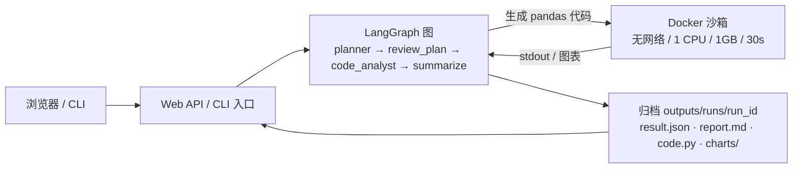
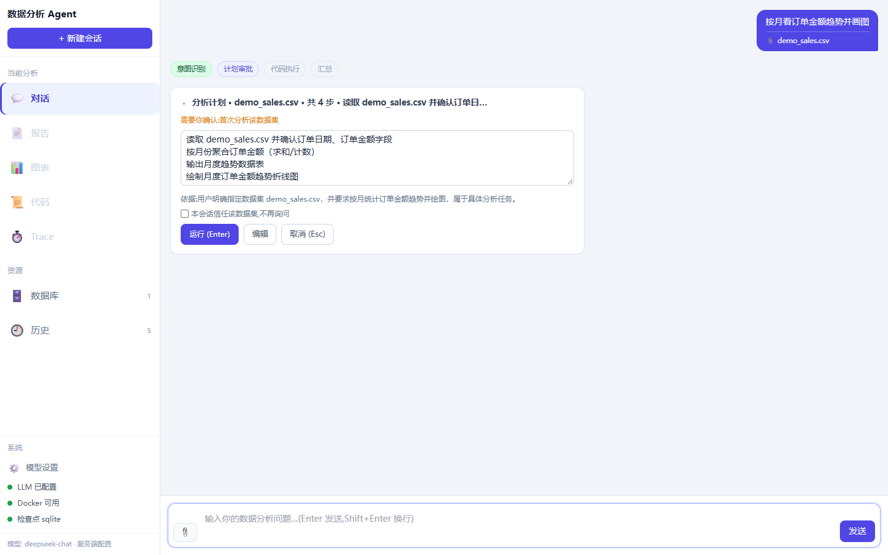
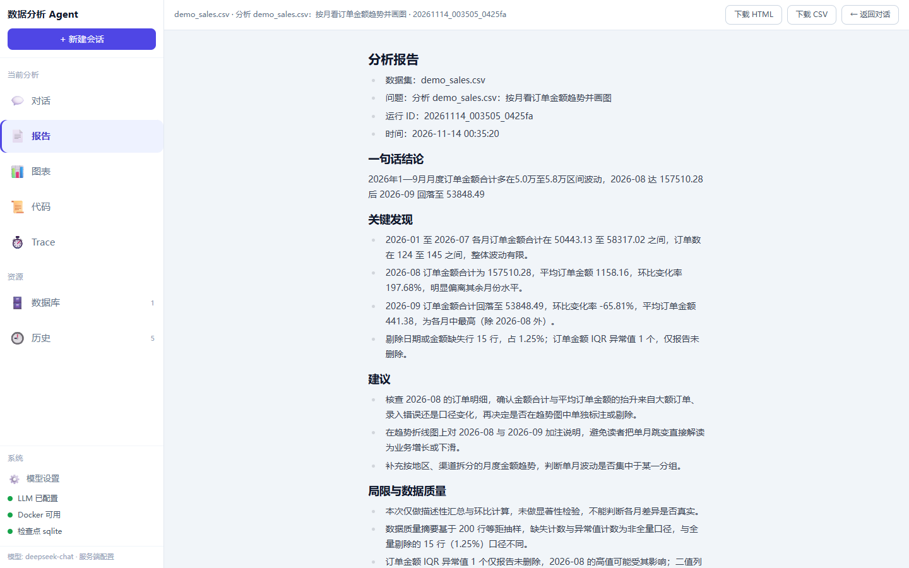
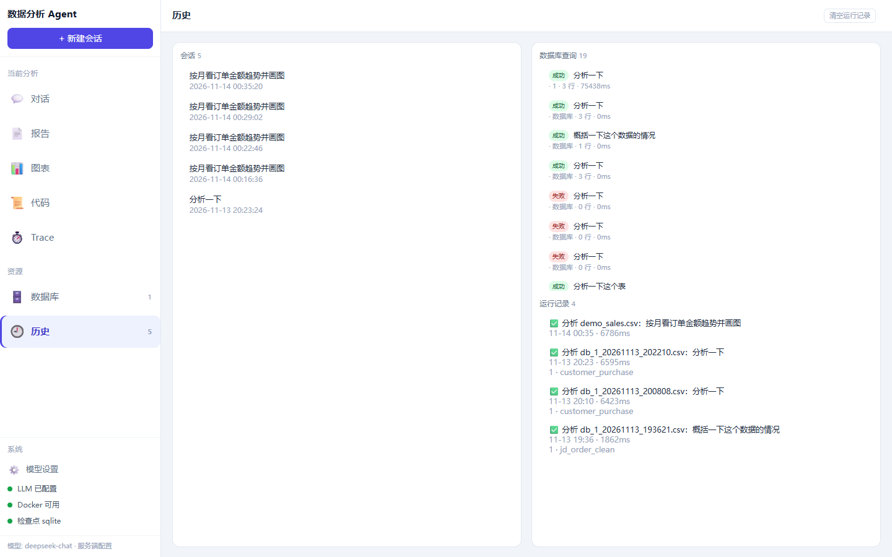

# 数据分析 Agent

**用一句自然语言,产出可复现的数据分析报告——AI 生成的代码只在 Docker 沙箱里执行。**

<!-- hero:start -->
**暂无数据** 个离线单元测试 · **9/9 (100.0%)** 回归用例通过 · 单轮沙箱耗时中位 **6.4 s** · **5** 个入口
<!-- hero:end -->

> 定位:**本地单用户工具**。只绑定 `127.0.0.1`,不做公网部署、不做鉴权、不做多租户。

```bash
git clone <your-repo-url> && cd model
scripts/bootstrap.ps1            # macOS / Linux: bash scripts/bootstrap.sh
# 浏览器打开 http://127.0.0.1:8000
```



---

## 它能做什么

| 你会问 | 它会产出 |
|---|---|
| 「按月看订单金额趋势并画图」 | 9 个月折线图 + 趋势解读,图表归档到 `outputs/runs/{run_id}/charts/` |
| 「按渠道拆一下客单价」 | 渠道对比表 + 差异结论,数字可回溯到本次执行的 `stdout` |
| 「统计一下 demo_sales.csv 的缺失值和异常值」 | 数据质量摘要 + IQR 异常值清单,并提示哪些列需要人工核对 |

三张演示截图(按 [docs/screenshot-checklist.md](docs/screenshot-checklist.md) 拍摄):





> 上传数据:点对话输入框左侧的 📎 上传 CSV / Excel / JSON,或从菜单里选已有数据集;
> 也可以把文件直接拖进对话区。附件随问题一起提交,左栏只保留「会话」与「历史运行」。

---

## 设计决策

| 决策 | 取舍(做法 → 代价) |
|---|---|
| 代码只在沙箱执行 | AI 生成的代码只通过 `execute_code` 进 Docker,主进程零 `exec`。<br>代价:每次执行多一次容器启动开销,且依赖本机 Docker。 |
| 数据不进上下文 | 只传 schema、`head(5)` 样本、空值率与统计摘要,全量数据留在磁盘。<br>代价:模型看不到原始细节,复杂清洗需要多轮追问。 |
| 审批分级而非全自动或全人工 | 确定性规则按「信任 + 高风险词 + PII + 文件大小」判定 auto / confirm。<br>代价:规则是白名单式的,新场景可能误判,仍需人工兜底。 |
| 结论要带数据指纹 | 报告写入 `文件名@sha256 前 12 位`、行数、编码、更新时间。<br>代价:数据一变指纹就变,历史结论不能直接复用。 |
| 重试上限是 3 次 | 失败时把 `stderr` 与错误分析回喂 LLM,第 3 次仍失败就终止。<br>代价:偶发的复杂错误可能来不及自愈,需要人工介入。 |
| 删除会话要连轨迹一起删 | 默认删除检查点、会话索引、trace、run 归档,并脱敏审批审计。<br>代价:删除不可撤销,演示时只建议删测试会话。 |

---

## 快速开始

### 1. 环境要求

- 主进程 Python 3.11–3.13;沙箱镜像固定 3.11
- Docker Desktop(沙箱后端)
- 本地 pandas 3.x 与沙箱镜像内 pandas 2.2.3 的差异只在统计入口会体现,若遇行为差异以镜像为准

### 2. 一键启动

Windows:

```powershell
scripts/bootstrap.ps1            # 正式启动
scripts/bootstrap.ps1 -DryRun    # 只打印 8 个步骤,不写入、不联网、不起容器
```

macOS / Linux:

```bash
bash scripts/bootstrap.sh
bash scripts/bootstrap.sh --dry-run
```

脚本会依次完成:检查 Python 版本 → 复用 / 创建 `.venv` 并安装依赖 → 检查 `.env` →
检查 `docker info` → 缺失镜像时自动构建 → 跑 `scripts/smoke.py` → 数据目录为空时生成演示数据 →
启动 `python web/run.py` 并打开 `http://127.0.0.1:8000`。

- `.env` 不存在时从 `.env.example` 复制,填入 `LLM_API_KEY` 后重新运行,退出码 2;
- Docker 未启动时给出中文提示,退出码 2;
- `data/processed/` 已有 CSV 时不覆盖,只提示跳过演示数据生成。

### 3. 手动安装与运行

```bash
pip install -r requirements.txt          # 生产依赖
pip install -r requirements-dev.txt      # 开发依赖(pytest / ruff,可选)

docker build -t data-agent-sandbox:py311 sandbox/
python web/run.py                        # 浏览器打开 http://127.0.0.1:8000
```

### 4. 配置 `.env`

复制 `.env.example` 为 `.env` 并填入真实 Key(也可以留空,改用页面里的 BYOK 设置)。完整环境变量:

| 变量 | 默认 | 含义 |
|---|---|---|
| `LLM_BASE_URL` | —(必填) | OpenAI 兼容接口地址 |
| `LLM_API_KEY` | —(必填) | 接口密钥 |
| `LLM_MODEL` | —(必填) | 模型名称(DeepSeek 用 `deepseek-chat`) |
| `LLM_TIMEOUT` | `60` | 单次 LLM 请求超时秒数 |
| `LLM_MAX_RETRIES` | `1` | LLM 请求失败重试次数 |
| `SANDBOX_BACKEND` | `docker` | 沙箱后端:`docker` / `e2b` |
| `SANDBOX_DATA_DIR` | `data/processed` | 沙箱数据目录 |
| `SANDBOX_TIMEOUT` | `30` | 单次沙箱执行超时秒数 |
| `CHECKPOINT_BACKEND` | `sqlite` | 检查点后端:`sqlite`(跨进程持久化)/ `memory` |
| `CHECKPOINT_PATH` | `outputs/checkpoints.sqlite` | SQLite 检查点文件路径 |
| `SUMMARY_ENABLED` | `true` | 是否调用 LLM 生成结论汇总(false 时走模板降级) |
| `SESSION_TOKEN_BUDGET` | `0` | 单次会话 token 预算(0 = 不限) |
| `APPROVAL_POLICY` | `risk` | 审批分级:`risk`(默认)/ `confirm`(每轮都问)/ `auto`(演示全放行) |
| `TRACE_ENABLED` | `true` | 是否写 `outputs/traces/*.json` |
| `DB_CACHE` | `1` | 数据库查询结果缓存开关,`0` 时读写均关闭 |
| `DB_CACHE_TTL_SECONDS` | `600` | 缓存有效期秒数 |
| `MYSQL_QUERY_TIMEOUT_MS` | `30000` | MySQL 单条 SQL 超时毫秒数(1000~300000) |
| `DB_QUERY_TIMEOUT_SECONDS` | `30` | SQLite 单条查询超时秒数 |

> 结构化输出使用 `method="function_calling"`:DeepSeek 不支持 `json_schema` 形式,
> 且 `deepseek-flash` 等思考模型不支持强制 `tool_choice`,因此模型选择 `deepseek-chat`。

### 5. 演示数据

演示数据全部由 `scripts/make_demo_data.py` 用固定种子生成,**不含任何真实业务数据**:

```bash
python scripts/make_demo_data.py
# examples/demo_sales.csv       1200 行:订单日期 / 地区 / 渠道 / 新客 / 订单金额 / 是否复购
#                               含 15 个缺失金额、8 个缺失渠道、3 个异常金额
# examples/demo_users_pii.csv   24 行:列名含"手机号""邮箱",值全部为不可达假值
# 默认复制到 data/processed/demo_sales.csv 与 demo_users_pii.csv
```

### 6. 其他 CLI 入口

```bash
python chat.py                                   # 交互式多轮 + 审批
python chat.py --thread-id <id>                  # 继续指定会话
python chat.py --resume <thread_id>              # 跨进程恢复暂停的审批
python analyze.py "data/processed/测试数据.csv" "统计行数并给出收入均值"
python analyze.py "sales.xlsx" "按月统计销售额趋势" --sheet Sheet1
python ask_stats.py "data/processed/测试数据.csv" "测试组和对照组的收入差异显著吗"
python ask_db.py "examples/ecommerce.db" "按渠道统计 GMV,并列出 Top5 商品"
```

**跨进程恢复审批**:`chat.py` 暂停在审批时进程被关闭后,检查点仍在 SQLite 里。用同一个
`thread_id` 执行 `python chat.py --resume <thread_id>`,会重新打印当时那份计划并进入 y/e/n 审批。
前提:`CHECKPOINT_BACKEND=sqlite`、两个进程使用同一个 `CHECKPOINT_PATH`、在同一台机器上。

---

## 数据库问答

在侧栏「数据库」里保存 MySQL / SQLite 连接后,选中连接即可直接提问:服务端生成 SQL、
只读执行,结果导出 CSV 交给分析链路;结果卡会展示实际执行的 SQL。

### 查询缓存

只读查询结果缓存在 `outputs/db_cache/<连接 id>/`,同一连接下仅空白不同的 SQL
共用一份缓存。默认 TTL **600 秒(10 分钟)**;命中时结果卡显示
「缓存 · 10 分钟内有效」徽章,`outputs/db_queries.jsonl` 对应记录 `"cached": true`。

- 关闭缓存:`DB_CACHE=0`(读写都关闭,每次都真查库);
- 调整有效期:`DB_CACHE_TTL_SECONDS`(默认 `600`);
- 查看用量:`python scripts/db_cache_admin.py --stats`;
- 清理过期:`python scripts/db_cache_admin.py --purge-expired --apply`;
- 清空指定连接:`python scripts/db_cache_admin.py --clear --db-id <连接 id> --apply`;
- 清空全部:`python scripts/db_cache_admin.py --clear --apply`;
- 总量上限:`DB_CACHE_MAX_MB`(默认 `200`),超限时 purge 会按 `created_at`
  从旧到新清理。

> 治理脚本默认 dry-run,不加 `--apply` 只打印「将删除 N 条 / 释放 X MB」。
> 缓存只保存 SELECT / SHOW / DESCRIBE / EXPLAIN 的结果,写语句永不缓存;
> 单条缓存超过 50MB 不落盘。

---

## 部署

### 模型连接:BYOK 与自托管

优先级固定为 **请求头 > 服务端 `.env`**:

- **BYOK(使用者自带)**:页面「⚙️ 模型设置」填 API Key / Base URL / Model,
  只保存在浏览器 `localStorage`,随请求头发送;服务端只写请求级 `ContextVar`,
  请求结束即重置,不落盘、不写日志。
- **自托管**:`.env` 里的 `LLM_BASE_URL` / `LLM_API_KEY` / `LLM_MODEL` 作为请求头缺省时的默认值。

启动时若本机未填 Key 且 `.env` 也没有 Key,顶部会显示黄色横幅
「请先在 ⚙️ 模型设置里填入 API Key」,并禁用发送按钮。


> 截图占位:按 [docs/screenshot-checklist.md](docs/screenshot-checklist.md) 拍摄后替换。

### 本地 / VPS / 平台限制

- 本地:`python web/run.py`,`.env` 配 Key 即可。
- VPS:`docker compose` 运行,但必须挂载 `/var/run/docker.sock`——这等于把宿主机
  Docker 的 root 权限交给容器,仅限可信环境。
- Render / Railway / GitHub Pages 无法运行 Docker 沙箱,只能看静态页;
  需要代码执行时把 `SANDBOX_BACKEND` 切到 `e2b`(已有开关)。
- 公网部署建议**强制 BYOK + 按 IP 限流**(例如每分钟 N 次),否则服务端 Key 会被刷。

完整步骤与风险说明见 [docs/deploy.md](docs/deploy.md)。

---

## 实测数据

<!-- metrics:start -->
| 指标 | 数值 | 口径 |
|---|---|---|
| 单元测试 | 暂无数据 | `pytest --collect-only -q`(--with-tests) |
| 回归评估 | 9/9 (100.0%) | 最新 eval_report_20261104_221402.json(2026-11-04T22:14:02) |
| 运行总数 / 成功率 | 9 / 100.0% | `outputs/index.jsonl` 的 status(只记录完成归档的运行) |
| 单轮沙箱耗时 | p50 6.4 s / 均值 5.2 s | index.jsonl 的 duration_ms(非空样本 9 条) |
| token 均值 | 8,604 | index.jsonl 的 token_used(跳过 null,样本 9 条) |
| 审批决策 | 84 次:auto 7 (8.3%) / confirm 77 (91.7%) | `outputs/approvals.jsonl` 的 level(auto / confirm)占比 |
| 人工拒绝 | 4 | decided_by=human 且 action=reject |
| 会话数 / 已删除 | 7 / 19 | sessions.jsonl / deletions.jsonl 去重 thread_id |

**测量口径**

- 机器: Windows 11 (AMD64);Python 3.13.9
- Docker: 29.8.2
- 模型: deepseek-chat(通过 OpenAI 兼容接口调用)
- 样本量: runs 9 条 / approvals 84 条 / sessions 7 条 / eval 9 条 / tests 0 条
- 生成方式: `python scripts/collect_metrics.py --with-tests`(不调 LLM、不起容器、不联网)

完整指标与说明见 [docs/metrics.md](docs/metrics.md)。
<!-- metrics:end -->

> 数字由 `scripts/collect_metrics.py` 从 `outputs/` 与 pytest 收集结果生成,不手写、不估算。
> 单轮耗时是**沙箱执行耗时**的中位数,不含 LLM 规划与审批等待,因此比端到端墙钟小。

---

## 示例输出

`python analyze.py "测试数据.csv" "统计行数并给出收入均值"`:

```text
[analyze] 结论:
读取 测试数据.csv,统计总行数并计算「收入」列均值。

   总行数       收入均值
0  800  68.348069

[analyze] 报告: outputs/reports/report_20261028_133550.md
```

报告包含:一句话结论、关键发现、建议、局限与数据质量、图表、口径与数据版本、生成代码、
耗时与尝试次数;数字可在同目录 `result.json` 的 `stdout` 中回溯。

---

## 项目结构

```text
model/
├── main.py            # 图装配与运行时入口(build_graph / run_agent / resume_agent)
├── common.py          # 节点共享:预算、问题解析、数据集绑定、交付意图
├── archive.py         # 运行归档:result.json / report.md / 图表 / index.jsonl
├── nodes/             # 四个节点各一模块
│   ├── planner.py     # 意图识别 + 数据集绑定 + 计划
│   ├── review.py      # 计划审批(HITL)与路由
│   ├── code_analyst.py# 代码生成 → 沙箱执行 → 失败重试
│   └── summarize.py   # 报告汇总 + 归档
├── checkpoint.py      # 检查点装配(SQLite / memory,缺包自动降级)
├── state.py           # AgentState 强类型状态定义
├── prompts.py         # 全部 prompt 模板(planner / codegen / 图表 / SQL / 统计 / 汇总)
├── llm.py             # LLM 客户端 + 结构化输出契约(含 ReportSummary)
├── reporting.py       # 统一报告渲染(analyze / ask_db / summarize 共用)
├── validate.py        # 结果 sanity check + 汇总数字溯源(只警告不阻断)
├── tools.py           # 白名单工具:list_datasets / describe_dataset / execute_code / fingerprint_text
├── sandbox.py         # Docker / E2B 沙箱后端(AI 代码唯一执行入口)
├── trace.py           # 节点 / LLM / 工具耗时记录
├── chat.py            # 交互式 CLI(多轮 + HITL 审批)
├── analyze.py         # 文件分析 CLI(CSV / Excel → Markdown 报告)
├── ask_stats.py       # 统计分析 CLI
├── ask_db.py          # SQLite 自然语言查询 CLI
├── stats.py           # 确定性统计计算(scipy / statsmodels)
├── db.py              # SQLite 只读访问 + SQL 安全校验
├── eval/
│   ├── cases.json     # 8 条回归用例
│   ├── judge.py       # LLM-as-judge(默认关闭)
│   └── run_eval.py    # 回归执行器(exit 0/1,--judge 开关)
├── web/
│   ├── app.py         # FastAPI 装配 + 共享状态/信号量
│   ├── routers/       # 端点按资源拆分:datasets / sessions / runs
│   ├── approval_policy.py  # 审批风险分级(确定性规则,不调 LLM)
│   ├── events.py      # 进度回调 → asyncio 队列桥接
│   ├── run.py         # 启动入口(workers=1,127.0.0.1:8000)
│   └── static/        # 单页前端(原生 JS + Tailwind CDN,无构建步骤)
├── scripts/
│   ├── bootstrap.ps1 / bootstrap.sh  # 一键启动(Windows / macOS-Linux)
│   ├── make_demo_data.py             # 固定种子生成演示数据
│   ├── collect_metrics.py            # 采集指标并更新 README 标记块
│   └── smoke.py                      # 冒烟自检(无 Docker / LLM)
├── examples/
│   ├── demo_sales.csv     # 1200 行合成订单数据
│   └── demo_users_pii.csv # 假 PII 数据,演示审批理由
├── docs/
│   ├── metrics.json / metrics.md  # 指标快照(脚本生成)
│   ├── demo-script.md             # 3 分钟演示剧本
│   ├── screenshot-checklist.md    # 截图清单
│   ├── portfolio.md               # 作品集一页
│   ├── interview-notes.md         # 面试讲稿与追问
│   └── images/                    # 截图占位
├── tests/                         # 离线单元测试
├── sandbox/
│   └── Dockerfile     # 沙箱镜像(pandas / numpy / matplotlib / 中文字体)
└── outputs/           # 运行产物(已在 .gitignore 中排除)
    ├── runs/<run_id>/ # result.json / report.md / code.py / charts/
    ├── index.jsonl    # 运行索引
    ├── traces/        # 节点 / LLM / 工具耗时
    ├── approvals.jsonl / deletions.jsonl / sessions.jsonl
    └── checkpoints.sqlite
```

---

## 设计要点

**沙箱隔离**:AI 生成的代码只通过 `sandbox.py` 执行;容器以 `--network none` 启动,
限制 `--memory 1g --cpus 1`,30s 超时强杀,代码与数据只读挂载。主进程仅用 `subprocess` 拉起容器。

**失败重试**:`route_after_code_analyst` 按「成功 → summarize;不可重试 → 结束;
iteration ≥ 3 → 结束;否则重试」路由,重试时把上一轮 `error_analysis` 回喂 LLM。

**结论与可复现**:`summarize` 节点先做 sanity check(空 stdout / 坏图 / 行数异常 / 全 NaN)
与汇总数字溯源,再生成「一句话结论 / 关键发现 / 建议 / 局限」;LLM 只允许引用执行输出里的数字,
超范围数字会进 `warnings` 并单列一节;报告与 `result.json` 落在 `outputs/runs/{run_id}/`。

**审批分级**:`web/approval_policy.py` 按「本会话已信任 → 高风险词 → PII 列 → 文件 > 50MB」
判定 `auto` 或 `confirm`;`auto` 轮次不弹卡但仍写 `outputs/approvals.jsonl`,
人工批准 / 编辑 / 拒绝同样落审计。任何策略异常一律回退 `confirm`,绝不自动放行。

**人工审批**:`review_plan` 用 LangGraph `interrupt` 暂停,`resume_agent` 用 `Command(resume=...)` 恢复;
检查点写入 SQLite,进程退出后仍可跨进程恢复;`auto_approve=True` 时跳过,供评估与工具模式使用。

**编码探测**:`describe_dataset` 依次尝试候选编码,把结果写入 schema,生成代码时显式传 `encoding=`。

**统计分析**:`stats.py` 用 scipy/statsmodels 做确定性计算(t 检验含正态性与方差齐性检查、
回归含 R² 与调整 R²),LLM 只负责选择方法与解读,避免生成不可复现的统计代码。

**数据治理**:Web 端删除会话时,默认删除该 thread 的检查点、会话索引、trace 与 run 归档,
并把 `approvals.jsonl` 中该会话的 question 置空、标记 `redacted: true`,同时写
`outputs/deletions.jsonl` 审计行。

**评估**:8 条用例覆盖发现、统计、分组、图表、缺失文件、意图不明、报告章节等场景;任一失败 exit 1。

---

## 已知限制

- 面向**单用户本地工具**:未做多用户、鉴权与并发隔离;Web 服务只绑 `127.0.0.1`、单 worker、全局串行执行;
- 沙箱只分析 CSV;xlsx 由主进程转成 CSV 后再进沙箱,parquet / json 等格式暂不支持;
- Excel 仅支持 `.xlsx`,`.xls` 需额外安装 `xlrd`;
- checkpointer 默认 SQLite,单实例本地文件,未做多进程并发写入隔离;
- 数据库问答支持 MySQL 与 SQLite,其他数据库需自行实现适配器;
- 统计方法限定 7 种(描述统计 / t 检验 / 卡方 / ANOVA / 相关 / 线性回归 / 样本量),
  不含逻辑回归与时间序列;
- 单元测试全部离线(不联网 / 不起 Docker / 不调 LLM),只覆盖确定性逻辑;端到端质量由 `eval/run_eval.py` 负责;
- LLM-as-judge 默认关闭(`--judge` 才启用),判分失败只打印警告,不影响 PASS/FAIL;
- 审批分级是确定性白名单规则,不做语义理解;新业务场景可能误判,仍需人工兜底。

---

## 怎么验证

```bash
python -m pytest -q                 # 离线单元测试(111 条,本机约 33 s)
python eval/run_eval.py             # 8 条端到端回归(需 Docker + LLM)
python scripts/smoke.py             # 冒烟自检(无需 Docker / LLM)
```

当前结果(2026-11-01,与「实测数据」同一口径):单元测试 **111 passed**,回归 **8/8**,
`scripts/smoke.py` 全部通过。精确数字见上方 metrics 块或 [docs/metrics.md](docs/metrics.md)。

---

## 技术栈

LangGraph · LangChain · DeepSeek(OpenAI 兼容)· pandas · NumPy · Matplotlib · SciPy ·
statsmodels · Docker · SQLite · FastAPI

---

## 免责声明

本项目为个人学习与自用工具,分析结论需人工复核;AI 生成的代码在沙箱中执行,
但不构成任何投资或业务决策建议。
